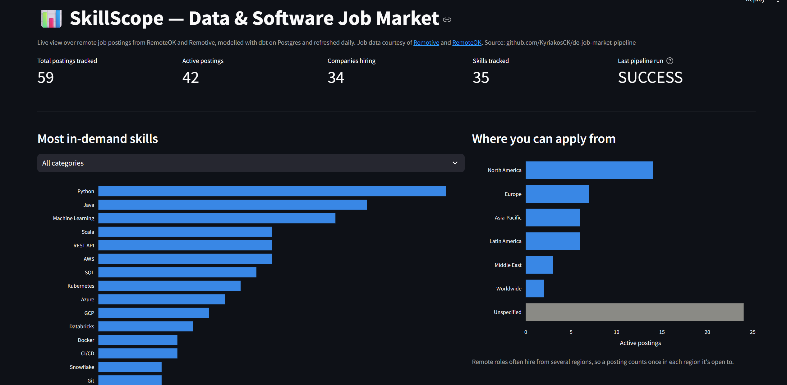
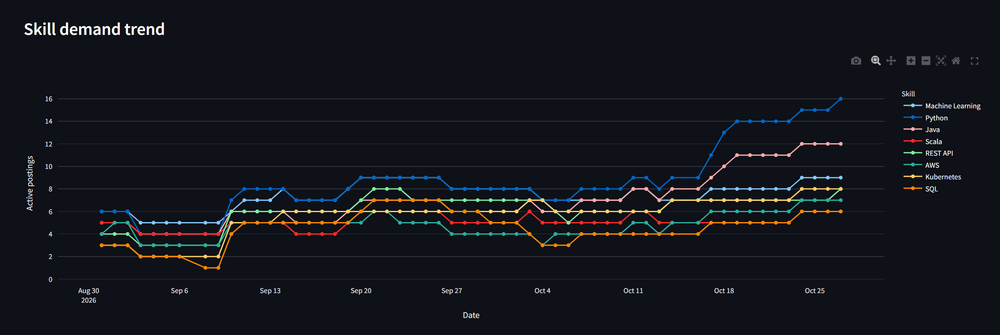
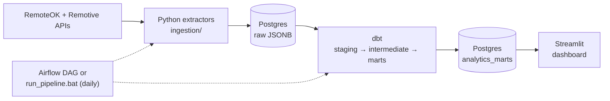
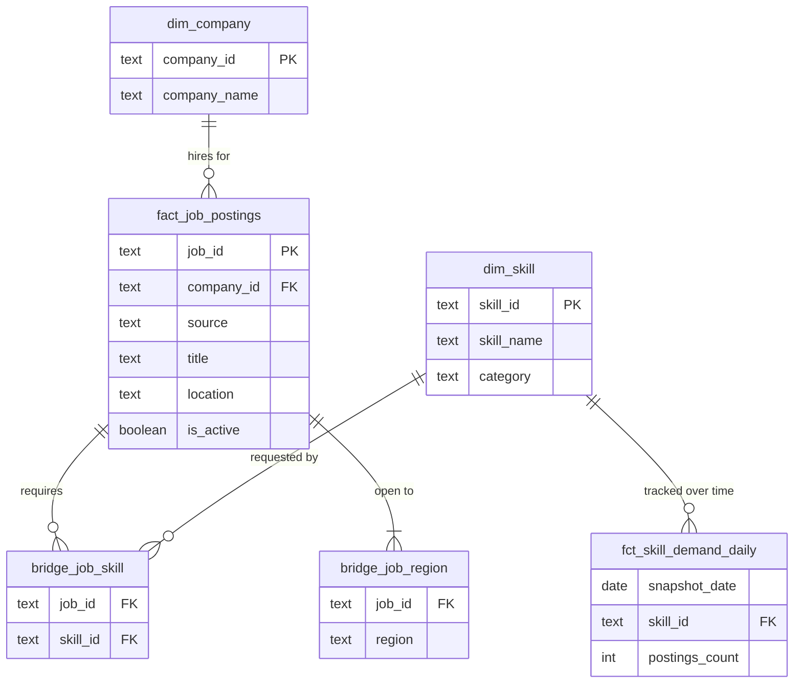

# SkillScope: Data & Software Job Market Pipeline

[](https://github.com/KyriakosCK/de-job-market-pipeline/actions/workflows/ci.yml)

A daily ELT pipeline that tracks which skills remote data and software jobs
ask for. It pulls postings from two public job board APIs, lands them as raw
JSON in Postgres, models them into a star schema with **dbt**, and serves the
results in a **Streamlit** dashboard. **Airflow** (Docker Compose) or a
scheduled script runs it once a day.



Because a snapshot is stored every day, the dashboard also shows how demand
for each skill changes over time:



## How it works



1. **Extract and load.** Each source has its own Python extractor. It fetches
   postings, drops the ones that aren't data or software roles, and upserts
   each payload as JSONB into a `raw.*` table. Every run, successful or
   not, is logged to `raw.load_runs`.
2. **Transform.** dbt flattens each source, combines them into one shape,
   tags skills against a keyword list, maps locations to hiring regions,
   and builds the marts. Tests run between layers, so bad data stops before
   it reaches the dashboard.
3. **Serve.** The dashboard reads only from `analytics_marts`.

| Layer | Tools |
|---|---|
| Ingestion | Python 3.11, `requests`, `psycopg2` |
| Storage | PostgreSQL |
| Transformation | dbt (staging, intermediate, marts, seeds, incremental model, tests) |
| Orchestration | Airflow 2.10, or `run_pipeline.bat` with Windows Task Scheduler |
| Dashboard | Streamlit, Plotly |
| Testing and CI | pytest, dbt tests, ruff, GitHub Actions |

## Data sources

| Source | What it covers | How irrelevant postings are filtered out |
|---|---|---|
| [RemoteOK](https://remoteok.com/api) | Remote jobs in every industry | Keywords at ingestion, then role keywords in the title |
| [Remotive](https://remotive.com/api/remote-jobs) | Remote jobs only | The category Remotive assigns each posting |

Adzuna was considered and left out: its API cuts descriptions off at 500
characters (too short to find skills), its salaries are estimates rather
than posted figures, and most results were UK office roles.

## Data model

| Table | One row per |
|---|---|
| `fact_job_postings` | posting, across all sources (with `is_active`) |
| `dim_company` / `dim_skill` | company / tracked skill |
| `bridge_job_skill` | (posting, skill) match |
| `bridge_job_region` | (posting, hiring region) |
| `mart_skill_demand` / `mart_postings_by_region` | skill / region, current counts |
| `fct_skill_demand_daily` | (day, skill): the history behind the trend chart |
| `mart_pipeline_runs` | ingestion run |

<details>
<summary>Entity-relationship diagram</summary>



</details>

Column docs and the lineage graph come from dbt:
`cd dbt/job_market && dbt docs generate && dbt docs serve`.

## Running it

**Locally (any Postgres):**

```bash
python -m venv .venv && source .venv/bin/activate
pip install -r requirements.txt dbt-postgres

# connection settings; see .env.example
export WAREHOUSE_HOST=localhost WAREHOUSE_PORT=5432 \
       WAREHOUSE_DB=warehouse WAREHOUSE_USER=jobmarket WAREHOUSE_PASSWORD=jobmarket

python -m ingestion.extract_remoteok
python -m ingestion.extract_remotive
(cd dbt/job_market && dbt build --profiles-dir .)
streamlit run dashboard/app.py
```

**With Docker Compose (Postgres, Airflow, and the dashboard):**

```bash
cp .env.example .env
docker compose up --build
```

Airflow runs at http://localhost:8080 (`admin` / `admin`); trigger the
`job_market_pipeline` DAG there. The dashboard runs at http://localhost:8501.

**Daily on Windows:** point a Task Scheduler task at `run_pipeline.bat`.
It runs both extractors and `dbt build`, writes `logs/pipeline_YYYY-MM-DD.log`,
and exits non-zero if any step fails.

## Testing

```bash
pytest -v --cov=ingestion                          # unit tests on fixtures from real API responses
(cd dbt/job_market && dbt build --profiles-dir .)  # models + 66 dbt tests
ruff check ingestion tests dashboard               # lint
```

CI runs all of these on every push: lint and unit tests, a full `dbt build`
against a throwaway Postgres loaded with fixture data, and a check that the
Airflow DAG imports cleanly.

## Design decisions

- **Raw JSON first.** Ingestion stores whole payloads instead of mapping
  them to columns. If a source changes its format, a dbt model fails with a
  clear error and ingestion keeps working.
- **Adding a source is three files:** an `extract_*.py`, a `stg_*.sql`
  model, and one `union all` line in `int_jobs_unioned`. Loading and run
  logging are shared in `ingestion/runner.py`.
- **Postings are never deleted.** A posting is active if it was seen in the
  last 14 days (configurable in `dbt_project.yml`), so history stays intact.
- **Daily history as an incremental model.** `fct_skill_demand_daily` adds
  one row per skill per day, and a rerun on the same day replaces that
  day's rows.
- **Fixing a broken source encoding.** RemoteOK's API garbles non-English
  text (`Macaé` arrives as `Macaé`). Ingestion repairs it, dbt blanks out
  anything still unreadable, and locations sent only in non-Latin scripts
  are translated through a seed. Warning-level tests report when either
  fallback is used.
- **Locations become hiring regions.** A remote job's location is often a
  list such as "LATAM, Europe, USA". Each posting is mapped to every region
  it mentions, so it counts once in each.

## Limitations

- Skill tagging matches keywords, so it can miss synonyms or match an
  unrelated use of a word.
- The APIs return only their most recent postings, so coverage depends on
  running every day.
- Many RemoteOK postings give no location, so "Unspecified" is the largest
  region.

## License

MIT, see [LICENSE](LICENSE).
